<!-- Generated by scripts/build.py from scripts/readme.template.md. Edit the template, not this file. -->
<a href="https://portfoliio-jet.vercel.app/"><picture><source media="(prefers-reduced-motion: reduce)" srcset="assets/static/cosmic-hero.svg"></picture></a>

<picture><source media="(prefers-color-scheme: dark) and (prefers-reduced-motion: reduce)" srcset="assets/static/band-01-identity-dark.svg"><source media="(prefers-color-scheme: dark)" srcset="assets/band-01-identity-dark.svg"><source media="(prefers-reduced-motion: reduce)" srcset="assets/static/band-01-identity-light.svg"></picture>

I work on the layer that decides whether an LLM system survives contact with production: **how models are adapted, how agents are evaluated, and how both run as dependable software.** Right now that means LoRA fine-tuning infrastructure for open-weight models, a statistical CI gate for LLM agents, and the Python and TypeScript services around them.

Working rule across every project below: *if a number was not measured, it is not shown.*

BHOPAL, INDIA &nbsp;·&nbsp; VELLORE INSTITUTE OF TECHNOLOGY &nbsp;·&nbsp; OPEN TO AI ENGINEERING ROLES

<picture><source media="(prefers-color-scheme: dark) and (prefers-reduced-motion: reduce)" srcset="assets/static/band-02-exploring-dark.svg"><source media="(prefers-color-scheme: dark)" srcset="assets/band-02-exploring-dark.svg"><source media="(prefers-reduced-motion: reduce)" srcset="assets/static/band-02-exploring-light.svg"></picture>

<picture><source media="(prefers-reduced-motion: reduce)" srcset="assets/static/research-grid.svg"></picture>

<picture><source media="(prefers-color-scheme: dark) and (prefers-reduced-motion: reduce)" srcset="assets/static/band-03-arsenal-dark.svg"><source media="(prefers-color-scheme: dark)" srcset="assets/band-03-arsenal-dark.svg"><source media="(prefers-reduced-motion: reduce)" srcset="assets/static/band-03-arsenal-light.svg"></picture>


<picture><source media="(prefers-color-scheme: dark) and (prefers-reduced-motion: reduce)" srcset="assets/static/band-04-work-dark.svg"><source media="(prefers-color-scheme: dark)" srcset="assets/band-04-work-dark.svg"><source media="(prefers-reduced-motion: reduce)" srcset="assets/static/band-04-work-light.svg"></picture>

<a href="https://github.com/AIZEN-Hado/Fisherman"><picture><source media="(prefers-reduced-motion: reduce)" srcset="assets/static/work-1-fisherman.svg"></picture></a>

A regression harness for LLM agents. Every run is traced with OpenTelemetry and stored in SQLite; cases are checked by deterministic rules and an LLM judge; multi-turn rollouts run against simulated users with hidden goals, including adversarial personas fishing for the system prompt; a GitHub Action replays baseline against candidate and blocks the merge on a significant regression. 
**WHY IT'S INTERESTING** &nbsp; The verdict rests on McNemar's exact test alone, with the paired-bootstrap interval reported only as effect size, because gating on both would push the real false-block rate above α. The judges are tested too: scored against a human-labelled golden set (accuracy, Cohen's κ) before they are allowed to gate.

<a href="https://github.com/AIZEN-Hado/SEMIgit"><picture><source media="(prefers-reduced-motion: reduce)" srcset="assets/static/work-2-semigit.svg"></picture></a>

A local-first VS Code extension that diffs code at the syntax-tree level as you work, scores whether a feature-sized milestone has been reached, and drafts a Conventional Commit from what actually changed. A Turborepo monorepo: a typed IPC contract, a local JSON-RPC service on SQLite, and a React 19 webview. 
**WHY IT'S INTERESTING** &nbsp; Fully offline by default, with a heuristic engine and no API keys. OpenAI, Anthropic, Gemini, DeepSeek or Ollama, and precise tree-sitter parsing, slot in behind clean interfaces, and keys stay in the OS keychain.

<a href="https://github.com/AIZEN-Hado/pseudoCV"><picture><source media="(prefers-reduced-motion: reduce)" srcset="assets/static/work-3-pseudocv.svg"></picture></a>

A Claude plugin and skill that reads a job description, checks your public repositories, and writes an ATS-ready one-page LaTeX resume from your real work, with an opt-in target resume and gap report that show what to build next. 
**WHY IT'S INTERESTING** &nbsp; It compiles the LaTeX and measures how full the page is, trimming or enriching until it fills exactly one page, without ever shrinking fonts or margins. It refuses to invent jobs, dates, grades or numbers.

<a href="https://github.com/AIZEN-Hado/CLASSLYAI"><picture><source media="(prefers-reduced-motion: reduce)" srcset="assets/static/work-4-classly.svg"></picture></a>

A learning management system and course marketplace for students, instructors and admins: course publishing, quizzes and analytics, Google sign-in, Stripe checkout with coupons and invoices, and AI tools for notes, quiz generation and answer checking. 
**WHY IT'S INTERESTING** &nbsp; The AI layer is provider-agnostic: one interface over OpenAI, Gemini and Anthropic written against their raw HTTP APIs, with no SDKs. Scanned or photographed answers are read with Tesseract OCR before an LLM grades them.

**ALSO IN ORBIT** &nbsp; [Offline UPI Mesh](https://github.com/AIZEN-Hado/Offline_upi) · RSA + AES-GCM payments relayed over a gossip mesh, idempotent settlement &nbsp;/&nbsp; [SentnelOps](https://github.com/AIZEN-Hado/SentnelOps_Assignment) · rules plus Isolation Forest anomaly detection &nbsp;/&nbsp; [InterviewIQ](https://github.com/AIZEN-Hado/3.interviewIQ) · AI interview platform

<picture><source media="(prefers-color-scheme: dark) and (prefers-reduced-motion: reduce)" srcset="assets/static/band-05-telemetry-dark.svg"><source media="(prefers-color-scheme: dark)" srcset="assets/band-05-telemetry-dark.svg"><source media="(prefers-reduced-motion: reduce)" srcset="assets/static/band-05-telemetry-light.svg"></picture>

<picture><source media="(prefers-reduced-motion: reduce)" srcset="assets/static/telemetry.svg"></picture>

<picture><source media="(prefers-color-scheme: dark) and (prefers-reduced-motion: reduce)" srcset="assets/static/band-06-frontier-dark.svg"><source media="(prefers-color-scheme: dark)" srcset="assets/band-06-frontier-dark.svg"><source media="(prefers-reduced-motion: reduce)" srcset="assets/static/band-06-frontier-light.svg"></picture>

> **Q.01 &nbsp;Regression, or noise?** 
> An agent changes: a prompt edit, a model version, a tool schema, a refactored loop. Its outputs are stochastic and multi-turn, so one run proves nothing either way. Which differences are real, and which layer caused them? 
> WORKING ANSWER · pass^k sampling, McNemar's exact test as a merge gate, trajectory diffs to locate the change &nbsp;·&nbsp; INSTRUMENT · Fisherman

> **Q.02 &nbsp;When is a judge allowed to judge?** 
> LLM-as-judge is cheap and scales, but a lenient judge quietly lets regressions through. How much agreement with human labels is enough before a judge may block a merge, and which deterministic checks must sit underneath it? 
> WORKING ANSWER · calibrate against a golden set (κ, FPR, FNR), back the judge with rule assertions &nbsp;·&nbsp; INSTRUMENT · Fisherman

> **Q.03 &nbsp;What does an adapter actually learn?** 
> LoRA trains a low-rank update on a frozen model. Separating a genuine domain gain from memorised formatting needs base and adapter evaluated on the same held-out examples, with provenance for both. 
> WORKING ANSWER · base-versus-adapter evaluation on held-out data, verified artifacts only &nbsp;·&nbsp; INSTRUMENT · fine-tuning platform (private, in development)

> **Q.04 &nbsp;Can structure define a unit of work?** 
> Time and line counts are weak proxies for "this feature is done". Can syntax-tree changes, weighted by depth, spread and confidence, recognise a meaningful milestone without asking the developer? 
> WORKING ANSWER · weighted milestone scoring over AST diffs &nbsp;·&nbsp; INSTRUMENT · SemiGit

<picture><source media="(prefers-color-scheme: dark) and (prefers-reduced-motion: reduce)" srcset="assets/static/band-07-contact-dark.svg"><source media="(prefers-color-scheme: dark)" srcset="assets/band-07-contact-dark.svg"><source media="(prefers-reduced-motion: reduce)" srcset="assets/static/band-07-contact-light.svg"></picture>

<picture><source media="(prefers-reduced-motion: reduce)" srcset="assets/static/contact-terminal.svg"></picture>

<a href="https://portfoliio-jet.vercel.app/"><picture><source media="(prefers-reduced-motion: reduce)" srcset="assets/static/channel-1-portfolio.svg"></picture></a> 
<a href="https://www.linkedin.com/in/yashsinghchauhan29"><picture><source media="(prefers-reduced-motion: reduce)" srcset="assets/static/channel-2-linkedin.svg"></picture></a> 
<a href="mailto:yashchauhan2905@gmail.com"><picture><source media="(prefers-reduced-motion: reduce)" srcset="assets/static/channel-3-email.svg"></picture></a> 
<a href="https://wa.me/918962125787"><picture><source media="(prefers-reduced-motion: reduce)" srcset="assets/static/channel-4-whatsapp.svg"></picture></a>

<picture><source media="(prefers-color-scheme: dark) and (prefers-reduced-motion: reduce)" srcset="assets/static/footer-dark.svg"><source media="(prefers-color-scheme: dark)" srcset="assets/footer-dark.svg"><source media="(prefers-reduced-motion: reduce)" srcset="assets/static/footer-light.svg">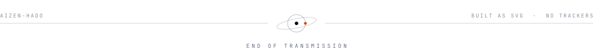</picture>
