<!-- Generated by scripts/build.py from scripts/profile.json. Do not edit by hand.
     Every image is a slice of one canvas; keep them in one paragraph with no whitespace between. -->

<a href="https://portfoliio-jet.vercel.app/"><picture><source media="(prefers-reduced-motion: reduce)" srcset="assets/static/cosmic-hero.svg"></picture></a><picture><source media="(prefers-reduced-motion: reduce)" srcset="assets/static/band-01-identity.svg"></picture><picture><source media="(prefers-reduced-motion: reduce)" srcset="assets/static/identity.svg"></picture><picture><source media="(prefers-reduced-motion: reduce)" srcset="assets/static/band-02-exploring.svg"></picture><picture><source media="(prefers-reduced-motion: reduce)" srcset="assets/static/research-grid.svg"></picture><picture><source media="(prefers-reduced-motion: reduce)" srcset="assets/static/band-03-arsenal.svg"></picture><picture><source media="(prefers-reduced-motion: reduce)" srcset="assets/static/arsenal.svg"></picture><picture><source media="(prefers-reduced-motion: reduce)" srcset="assets/static/band-04-work.svg"></picture><a href="https://github.com/AIZEN-Hado/Fisherman"><picture><source media="(prefers-reduced-motion: reduce)" srcset="assets/static/work-1-fisherman.svg"></picture></a><a href="https://github.com/AIZEN-Hado/Fisherman"><picture><source media="(prefers-reduced-motion: reduce)" srcset="assets/static/work-1-notes.svg"></picture></a><a href="https://github.com/AIZEN-Hado/SEMIgit"><picture><source media="(prefers-reduced-motion: reduce)" srcset="assets/static/work-2-semigit.svg"></picture></a><a href="https://github.com/AIZEN-Hado/SEMIgit"><picture><source media="(prefers-reduced-motion: reduce)" srcset="assets/static/work-2-notes.svg"></picture></a><a href="https://github.com/AIZEN-Hado/pseudoCV"><picture><source media="(prefers-reduced-motion: reduce)" srcset="assets/static/work-3-pseudocv.svg"></picture></a><a href="https://github.com/AIZEN-Hado/pseudoCV"><picture><source media="(prefers-reduced-motion: reduce)" srcset="assets/static/work-3-notes.svg"></picture></a><a href="https://github.com/AIZEN-Hado/CLASSLYAI"><picture><source media="(prefers-reduced-motion: reduce)" srcset="assets/static/work-4-classly.svg"></picture></a><a href="https://github.com/AIZEN-Hado/CLASSLYAI"><picture><source media="(prefers-reduced-motion: reduce)" srcset="assets/static/work-4-notes.svg"></picture></a><picture><source media="(prefers-reduced-motion: reduce)" srcset="assets/static/also-0.svg"></picture><a href="https://github.com/AIZEN-Hado/Offline_upi"><picture><source media="(prefers-reduced-motion: reduce)" srcset="assets/static/also-1.svg"></picture></a><a href="https://github.com/AIZEN-Hado/SentnelOps_Assignment"><picture><source media="(prefers-reduced-motion: reduce)" srcset="assets/static/also-2.svg"></picture></a><a href="https://github.com/AIZEN-Hado/3.interviewIQ"><picture><source media="(prefers-reduced-motion: reduce)" srcset="assets/static/also-3.svg"></picture></a><picture><source media="(prefers-reduced-motion: reduce)" srcset="assets/static/band-05-telemetry.svg"></picture><picture><source media="(prefers-reduced-motion: reduce)" srcset="assets/static/telemetry.svg"></picture><picture><source media="(prefers-reduced-motion: reduce)" srcset="assets/static/band-06-frontier.svg"></picture><picture><source media="(prefers-reduced-motion: reduce)" srcset="assets/static/frontier.svg"></picture><picture><source media="(prefers-reduced-motion: reduce)" srcset="assets/static/band-07-contact.svg"></picture><picture><source media="(prefers-reduced-motion: reduce)" srcset="assets/static/contact-terminal.svg"></picture><a href="https://portfoliio-jet.vercel.app/"><picture><source media="(prefers-reduced-motion: reduce)" srcset="assets/static/channel-1-portfolio.svg"></picture></a><a href="https://www.linkedin.com/in/yashsinghchauhan29"><picture><source media="(prefers-reduced-motion: reduce)" srcset="assets/static/channel-2-linkedin.svg"></picture></a><a href="mailto:yashchauhan2905@gmail.com"><picture><source media="(prefers-reduced-motion: reduce)" srcset="assets/static/channel-3-email.svg"></picture></a><a href="https://wa.me/918962125787"><picture><source media="(prefers-reduced-motion: reduce)" srcset="assets/static/channel-4-whatsapp.svg"></picture></a><picture><source media="(prefers-reduced-motion: reduce)" srcset="assets/static/footer.svg"></picture>

