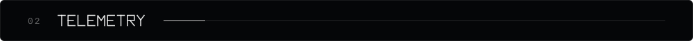
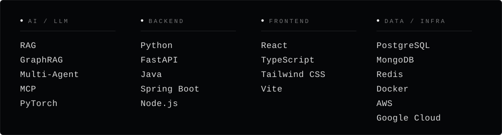

AI engineer and full stack developer building LLM systems that go beyond the notebook and into production: RAG, GraphRAG, multi-agent orchestration, and the Python services behind them.

  
  
  
  

